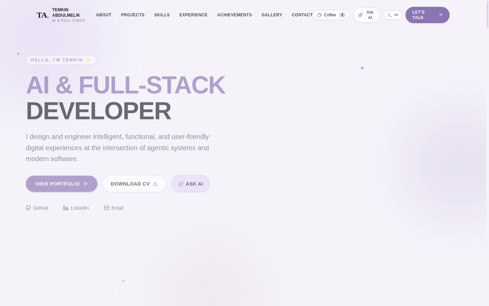
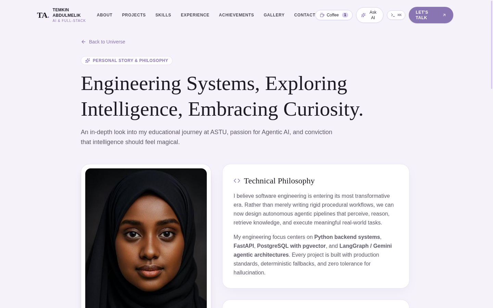
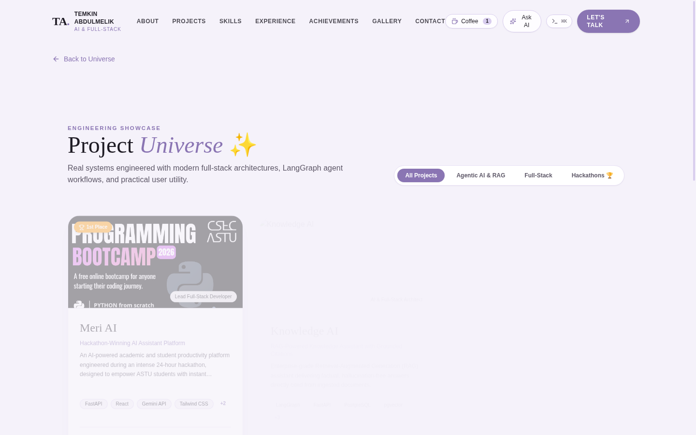
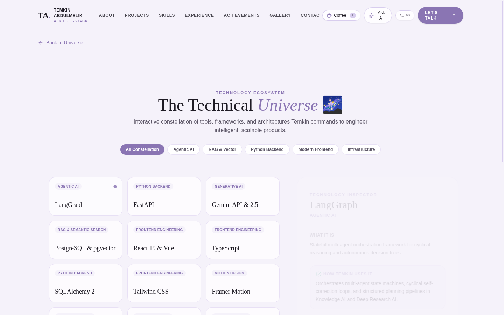
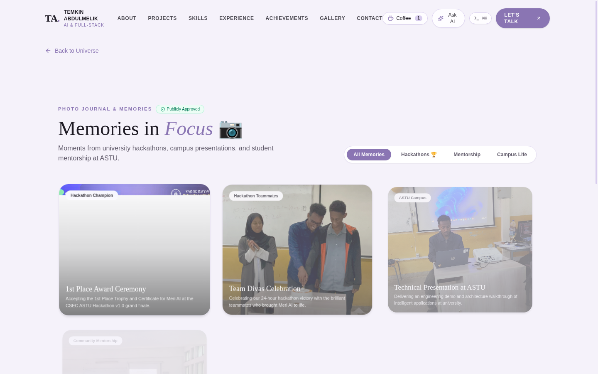
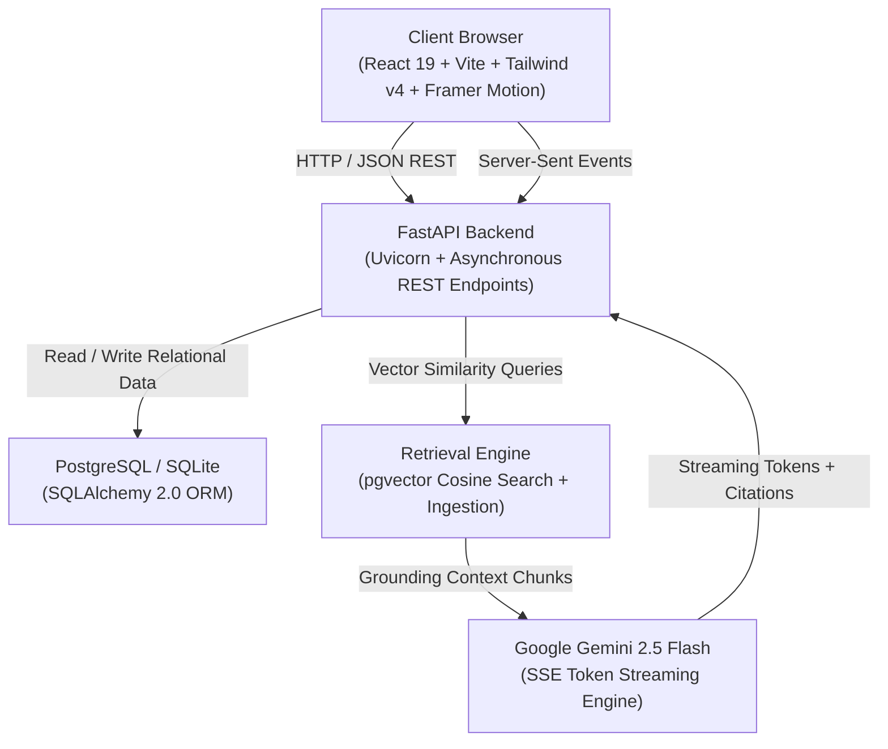

<div align="center">

# ✨ Temkin's World
### AI-Powered Personal Portfolio & Digital Identity Platform

[](https://opensource.org/licenses/MIT)
[](https://react.dev)
[](https://fastapi.tiangolo.com)
[](https://python.org)
[](https://tailwindcss.com)
[](https://docker.com)
[](https://github.com/Temkin236/portfolio/actions)

<p align="center">
  <b>Personal digital universe of Temkin Abdulmelik</b><br/>
  Electronics & Communication Engineering Student at ASTU • 1st Place CSEC ASTU Hackathon Winner • Agentic AI & Full-Stack Developer
</p>

[Explore Projects](#-featured-projects) • [System Architecture](#-system-architecture) • [Screenshots](#-interface-gallery) • [Local Setup](#-quickstart) • [Admin Studio](#-admin-studio)

</div>

---

## 📸 Interface Gallery

### 1. Editorial Hero & Experience Matrix


### 2. Storytelling & Authentic Biography


### 3. Project Universe & Case Studies


### 4. Interactive Tech Constellation


### 5. Memory Vault & Photography Gallery


---

## 🏛️ System Architecture



---

## 🛠️ Technology Stack

| Layer | Technologies |
|---|---|
| **Frontend** | React 19, TypeScript, Vite, Tailwind CSS v4, Framer Motion, Canvas Confetti, React Router DOM v7 |
| **Backend** | Python 3.12, FastAPI, Uvicorn, SQLAlchemy 2.0, Pydantic v2, Pytest |
| **AI / RAG** | Google Gemini API (Gemini 2.5 Flash), LangGraph, PostgreSQL with `pgvector`, Server-Sent Events (SSE) |
| **DevOps & Containers** | Docker, Docker Compose, Nginx, GitHub Actions (CI & CodeQL) |
| **Design System** | Bespoke Luxury Lilac Palette (`#F5F2FA`, `#D8CDEE`, `#8A75B3`, `#1E1B24`) |

---

## 🚀 Featured Projects

- **Meri AI (1st Place Hackathon Winner)**: Academic productivity & assistant platform engineered in 24 hours at CSEC ASTU Hackathon v1.0.
- **Knowledge AI**: Enterprise-grade RAG knowledge assistant with pgvector cosine similarity search and cited document provenance.
- **ASTU Campus Navigator**: AI geospatial routing and campus information portal combining Leaflet with LangGraph.
- **AURA AI**: Multi-persona conversational AI companion featuring real-time token streaming and 23 automated tests.
- **ASTU CoANS Portal**: Academic portal for the College of Applied Natural Sciences with departmental directory.

---

## ⚡ Quickstart

### Prerequisites
- Node.js 20+
- Python 3.12+
- Git

### 1. Clone the repository
```bash
git clone https://github.com/Temkin236/portfolio.git
cd portfolio
```

### 2. Run with Docker Compose (Recommended)
```bash
docker compose up -d --build
```
- Frontend: `http://localhost:3000`
- Backend API Docs: `http://localhost:8000/docs`

### 3. Run Manually

#### Frontend
```bash
cd frontend
npm install
npm run dev
```

#### Backend
```bash
cd backend
python3 -m venv .venv
source .venv/bin/activate
pip install -r requirements.txt
python -m uvicorn app.main:app --reload --port 8000
```

---

## 🛡️ Admin Studio

The platform includes a private, protected administration studio to manage projects, verify contact inquiries, update timeline events, and curate photography.

- **Route**: `http://localhost:3000/admin`
- **Default Credentials**: `temkin` / `temkin2026`

---

## 🧪 Testing & Quality Assurance

```bash
# Backend pytest suite (15 passing tests)
cd backend && pytest tests -v

# Frontend TypeScript verification & production bundle
cd frontend && npm run build
```

---

## 🤝 Contributing

Contributions, issues, and feature requests are welcome! See [CONTRIBUTING.md](CONTRIBUTING.md) for guidelines.

## 📄 License

This project is licensed under the MIT License - see the [LICENSE](LICENSE) file for details.

---

<div align="center">
  <b>Designed & Engineered with 💜 by Temkin Abdulmelik</b><br/>
  ASTU • Electronics & Communication Engineering '27
</div>
