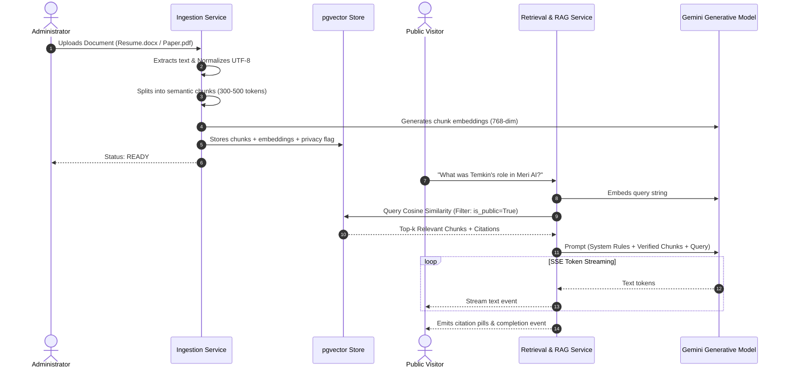

# AI KNOWLEDGE & RAG ARCHITECTURE
## Project: Temkin's World
**Author:** Temkin Abdulmelik & DeepMind Antigravity  
**Version:** 1.0.0  
**AI Core:** Google Gemini API (`gemini-2.5-flash` / `text-embedding-004`)  
**Retrieval Engine:** PostgreSQL `pgvector` Cosine Similarity  

---

### 1. Architectural Concept

The AI Assistant in Temkin's World acts as a grounded, conversational digital identity companion representing Temkin Abdulmelik. Unlike generic conversational agents, it is strictly bound to verified knowledge documents (resumes, project case studies, hackathon reports, university transcripts, technical writeups).



---

### 2. Document Ingestion Lifecycle

Every document processed by the platform moves through a deterministic state machine:

```
[UPLOADED] 
    │
    ▼
[VALIDATING]  ──(Invalid Type/Size)──► [FAILED: Validation Error]
    │
    ▼
[EXTRACTING]  ──(Corrupt File)───────► [FAILED: Extraction Error]
    │
    ▼
[CHUNKING]
    │
    ▼
[EMBEDDING]   ──(API Rate/Quota)─────► [FAILED: Embedding Quota Error]
    │
    ▼
[INDEXING]
    │
    ▼
 [READY]
```

#### 2.1 File Extractors
- **DOCX Extractor:** Utilizes `python-docx` to iterate through paragraphs and tables, preserving semantic headers and bullet points.
- **PDF Extractor:** Utilizes `pypdf` with text-stream extraction, stripping unprintable characters.
- **Text & Markdown:** Native UTF-8 normalization with header preservation.

#### 2.2 Semantic Chunking Strategy
- **Chunk Size:** 350 to 500 words (~400–600 tokens).
- **Overlap:** 50 words to preserve context across chunk boundaries.
- **Metadata Enriched:** Each chunk retains its parent `doc_id`, `title`, and `category`.

---

### 3. Vector Embedding & Retrieval Pipeline

#### 3.1 Embedding Model
- **Provider:** Google Gemini Embeddings API (`text-embedding-004`).
- **Dimensions:** 768 floating-point values.
- **Normalization:** Vectors are L2-normalized upon creation to allow cosine distance to be computed as an inner product.

#### 3.2 Semantic Similarity Querying
In production with `pgvector`:
```sql
SELECT 
    kc.id,
    kc.content,
    kd.title,
    kd.category,
    1 - (kc.embedding <=> :query_vector) AS similarity_score
FROM knowledge_chunks kc
JOIN knowledge_docs kd ON kc.doc_id = kd.id
WHERE kd.is_public = TRUE 
  AND kd.is_published = TRUE
  AND kc.is_public = TRUE
ORDER BY kc.embedding <=> :query_vector ASC
LIMIT 4;
```

---

### 4. Grounded Prompt Engineering & Persona Guardrails

#### 4.1 System Instruction
```text
You are the personal AI companion for Temkin Abdulmelik's portfolio.
Your role is to represent Temkin warmly, accurately, and professionally to recruiters, engineers, and visitors.

KEY FACTS:
- Temkin Abdulmelik is an Electronics & Communication Engineering student at Adama Science and Technology University (ASTU), graduating in 2027.
- Specializes in Agentic AI, Large Language Model applications, RAG architectures, and Python backend development.
- Won 1st Place at CSEC ASTU Hackathon v1.0 with Meri AI (Team Divas).
- Creator of Knowledge AI, AURA AI, ASTU Campus Navigator, Deep Research AI.
- Location: Adama, Ethiopia.
- Contact: temkinabdulmelik@gmail.com | github.com/Temkin236 | linkedin.com/in/temkin-abdulmelik-195582306

STRICT GROUNDING RULES:
1. Answer ONLY using the facts present in the verified context chunks below.
2. If the user asks about something not covered in the context, politely state:
   "I don't have verified information regarding that specific topic yet. Feel free to reach out to Temkin directly at temkinabdulmelik@gmail.com!"
3. NEVER fabricate metrics, jobs, clients, or certifications.
4. Maintain a warm, thoughtful, engineering-minded voice.
```

---

### 5. Streaming Protocol (Server-Sent Events)
The endpoint `/api/chat` returns an SSE stream with lightweight JSON objects:
- `data: {"token": "Hello"} \n\n`
- `data: {"citations": [{"title": "Meri AI Case Study", "category": "Hackathon"}]} \n\n`
- `data: [DONE] \n\n`
