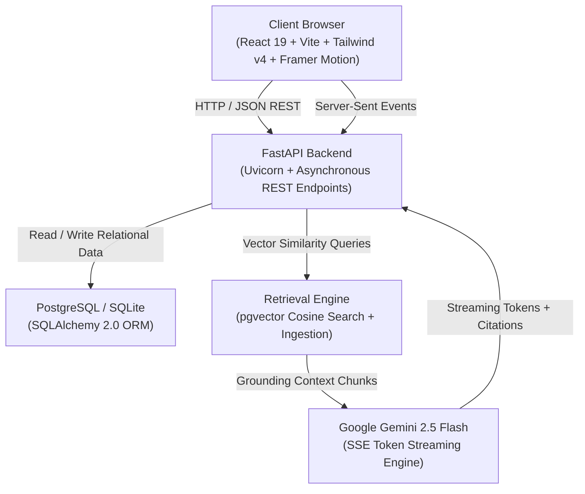

# Temkin's World — System Architecture Specification

## Overview
**Temkin's World** is a production full-stack digital portfolio and AI identity platform. It is engineered with a modern reactive frontend, a high-throughput async Python backend, and grounded Retrieval-Augmented Generation (RAG).

## Frontend Architecture
- **Framework**: React 19 Single Page Application (SPA).
- **Router**: React Router DOM v7 with client-side history navigation and custom scroll restoration.
- **Styling**: Tailwind CSS v4 with bespoke luxury lilac design system:
  - Primary Background: `#F5F2FA` (Alabaster Lilac)
  - Secondary Accent: `#D8CDEE` (Pastel Lavender)
  - Brand Primary: `#8A75B3` (Royal Amethyst)
  - Editorial Dark: `#1E1B24` (Deep Obsidian)
- **Animation Physics**: Framer Motion spring physics with `canvas-confetti` particle celebrations.

## Backend Architecture
- **Web Framework**: FastAPI (ASGI asynchronous runtime).
- **ORM & Database**: SQLAlchemy 2.0 with type-safe model definitions.
- **Security & Auth**:
  - JWT Bearer authentication for Admin Studio.
  - PBKDF2/Bcrypt password hashing.
  - Strict security response headers (`X-Content-Type-Options: nosniff`, `X-Frame-Options: DENY`).
- **AI Agent & Grounding**:
  - Semantic vector search across verified documentation chunks.
  - Prompt boundary enforcement to prevent hallucination.
  - Real-time streaming response over Server-Sent Events (SSE).
