# DATABASE DESIGN SPECIFICATION
## Project: Temkin's World
**Author:** Temkin Abdulmelik & DeepMind Antigravity  
**Version:** 1.0.0  
**Database Engines:** PostgreSQL 16+ with `pgvector` (Production) / SQLite (Local Dev Fallback)  
**ORM:** SQLAlchemy 2.0  
**Migration Tool:** Alembic  

---

### 1. Entity Relationship Diagram (ERD)

```mermaid
erDiagram
    USERS ||--o{ ADMIN_ACTIVITY_LOGS : performs
    PROFILES ||--o{ ASSISTANT_SETTINGS : configures
    PROJECTS ||--o{ PROJECT_TECHNOLOGIES : requires
    TECHNOLOGIES ||--o{ PROJECT_TECHNOLOGIES : utilized_in
    GALLERY_COLLECTIONS ||--o{ GALLERY_ASSETS : contains
    KNOWLEDGE_DOCUMENTS ||--o{ KNOWLEDGE_CHUNKS : contains
    KNOWLEDGE_DOCUMENTS ||--o{ KNOWLEDGE_VERSIONS : tracks
    CONVERSATIONS ||--o{ MESSAGES : has
    
    USERS {
        uuid id PK
        string username UK
        string email UK
        string hashed_password
        string role
        boolean is_active
        datetime created_at
    }

    PROFILES {
        int id PK
        string name
        string headline
        string supporting_headline
        text bio
        string location
        string university
        string degree
        string graduation_year
        string status_indicator
        string github_url
        string linkedin_url
        string email
        string resume_url
        string avatar_url
        string banner_url
        json interests
        json coffee_quotes
        json personal_facts
        int coffees_brewed_count
        int cheers_count
        datetime updated_at
    }

    PROJECTS {
        int id PK
        string slug UK
        string title
        string subtitle
        string category
        text description
        text problem
        text solution
        text contribution
        text architecture
        json tech_stack
        json key_decisions
        text challenges
        text achievements
        string github_url
        string live_url
        string cover_image
        json screenshots
        boolean featured
        string status
        int sort_order
        datetime created_at
        datetime updated_at
    }

    TECHNOLOGIES {
        int id PK
        string name UK
        string category
        text description
        text how_used
        json related_projects
        string icon
        int sort_order
    }

    TIMELINE_EVENTS {
        int id PK
        string year
        string title
        string role_or_context
        text description
        string category
        boolean highlight
        int sort_order
    }

    GALLERY_ASSETS {
        int id PK
        string title
        text caption
        string image_url
        string category
        boolean is_public
        string date_taken
        int sort_order
        datetime created_at
    }

    KNOWLEDGE_DOCUMENTS {
        int id PK
        string title
        string category
        string file_name
        string file_type
        text raw_content
        string status
        boolean is_published
        boolean is_public
        int version
        datetime created_at
        datetime updated_at
    }

    KNOWLEDGE_CHUNKS {
        int id PK
        int doc_id FK
        int chunk_index
        text content
        boolean is_public
        vector embedding
        text embedding_json
    }

    CONTACT_SUBMISSIONS {
        int id PK
        string name
        string email
        string subject
        text message
        string inquiry_type
        boolean is_read
        boolean is_archived
        datetime created_at
    }

    ANALYTICS_EVENTS {
        int id PK
        string path
        string referer
        string user_agent
        string event_type
        json metadata_json
        datetime timestamp
    }

    QUESTION_LOGS {
        int id PK
        text question
        text answer_preview
        json sources_cited
        float confidence
        datetime created_at
    }
```



---

### 2. Comprehensive Table Definitions

#### 2.1 Identity & Content Tables

##### `profiles`
The primary digital persona record for Temkin Abdulmelik.
- `id`: Integer or UUID, Primary Key.
- `name`: `VARCHAR(100)`, Default: `"Temkin Abdulmelik"`.
- `headline`: `VARCHAR(200)`, Professional title.
- `supporting_headline`: `VARCHAR(255)`, E.g., `"Building things that make intelligence feel magical."`.
- `bio`: `TEXT`, Editorial personal narrative.
- `location`: `VARCHAR(100)`, E.g., `"Adama, Ethiopia"`.
- `university`: `VARCHAR(150)`, E.g., `"Adama Science and Technology University"`.
- `degree`: `VARCHAR(150)`, E.g., `"B.Sc. Electronics and Communication Engineering (ECE)"`.
- `graduation_year`: `VARCHAR(20)`, E.g., `"2027"`.
- `status_indicator`: `VARCHAR(100)`, Availability status.
- `github_url`, `linkedin_url`, `email`, `resume_url`, `avatar_url`, `banner_url`: `VARCHAR(255)`.
- `interests`: `JSONB` array of interest topics.
- `coffee_quotes`: `JSONB` array of rotating coffee quotes.
- `personal_facts`: `JSONB` array of 6-dimension discovery cards.
- `coffees_brewed_count`: `INTEGER`, Default: `142`.
- `cheers_count`: `INTEGER`, Default: `98`.
- `updated_at`: `TIMESTAMP WITH TIME ZONE`.

##### `projects`
Showcase of engineering projects and case studies.
- `id`: Integer/UUID, Primary Key.
- `slug`: `VARCHAR(100)`, Unique, Indexed (e.g. `"meri-ai"`, `"knowledge-ai"`).
- `title`: `VARCHAR(150)`, Not Null.
- `subtitle`: `VARCHAR(255)`.
- `category`: `VARCHAR(50)`, Indexed (e.g. `"Agentic AI"`, `"Full-Stack & Web"`, `"Hackathon & Systems"`).
- `description`: `TEXT`, High-level summary.
- `problem`, `solution`, `contribution`, `architecture`: `TEXT`, Detailed case study sections.
- `tech_stack`: `JSONB` array of string technologies.
- `key_decisions`: `JSONB` array of architectural tradeoffs.
- `challenges`, `achievements`: `TEXT`.
- `github_url`, `live_url`, `cover_image`: `VARCHAR(255)`.
- `screenshots`: `JSONB` array of image URLs.
- `featured`: `BOOLEAN`, Default: `False`.
- `status`: `VARCHAR(20)`, Default: `"published"` (`"draft"`, `"published"`, `"archived"`).
- `sort_order`: `INTEGER`, Default: `0`.
- `created_at`, `updated_at`: `TIMESTAMP WITH TIME ZONE`.

##### `technologies`
Interactive technical universe elements.
- `id`: Integer/UUID, Primary Key.
- `name`: `VARCHAR(100)`, Unique, Indexed.
- `category`: `VARCHAR(50)`, Indexed (e.g. `"Agentic AI & LLMs"`, `"Python & Backend"`, `"Frontend & Design"`, `"Databases & Storage"`, `"DevOps & Tools"`).
- `description`: `TEXT`.
- `how_used`: `TEXT`, Concrete context on where Temkin employed this tool.
- `related_projects`: `JSONB` array of associated project slugs.
- `icon`: `VARCHAR(50)`, Lucide icon identifier.
- `sort_order`: `INTEGER`, Default: `0`.

##### `timeline_events`
Chronological milestone and career trajectory.
- `id`: Integer/UUID, Primary Key.
- `year`: `VARCHAR(30)`.
- `title`: `VARCHAR(150)`, Not Null.
- `role_or_context`: `VARCHAR(150)`.
- `description`: `TEXT`.
- `category`: `VARCHAR(50)` (`"Education"`, `"Career"`, `"Milestone"`, `"Hackathon"`).
- `highlight`: `BOOLEAN`, Default: `False`.
- `sort_order`: `INTEGER`, Default: `0`.

##### `photos` (Gallery Assets)
Visual artifacts and memories.
- `id`: Integer/UUID, Primary Key.
- `title`: `VARCHAR(150)`, Not Null.
- `caption`: `TEXT`.
- `image_url`: `VARCHAR(255)`, Not Null.
- `category`: `VARCHAR(50)` (`"Milestones"`, `"Hackathons"`, `"Campus Life"`, `"Engineering"`).
- `is_public`: `BOOLEAN`, Default: `True`, Indexed. **Critical Privacy Boundary.**
- `date_taken`: `VARCHAR(50)`.
- `sort_order`: `INTEGER`, Default: `0`.
- `created_at`: `TIMESTAMP WITH TIME ZONE`.

---

#### 2.2 Knowledge & Vector Store Tables

##### `knowledge_docs`
Uploaded raw source documents.
- `id`: Integer/UUID, Primary Key.
- `title`: `VARCHAR(200)`, Not Null.
- `category`: `VARCHAR(50)`, Default: `"Public Bio"`.
- `file_name`: `VARCHAR(255)`.
- `file_type`: `VARCHAR(20)` (`"docx"`, `"pdf"`, `"txt"`, `"md"`, `"manual"`).
- `raw_content`: `TEXT`.
- `status`: `VARCHAR(30)`, Processing lifecycle: `UPLOADED`, `EXTRACTING`, `CHUNKING`, `EMBEDDING`, `INDEXING`, `READY`, `FAILED`.
- `is_published`: `BOOLEAN`, Default: `True`, Indexed.
- `is_public`: `BOOLEAN`, Default: `True`, Indexed. **Exclusion filter for public AI assistant.**
- `version`: `INTEGER`, Default: `1`.
- `created_at`, `updated_at`: `TIMESTAMP WITH TIME ZONE`.

##### `knowledge_chunks`
Segmented text chunks with high-dimensional vector representations.
- `id`: Integer/UUID, Primary Key.
- `doc_id`: Foreign Key referencing `knowledge_docs.id` with `ON DELETE CASCADE`.
- `chunk_index`: `INTEGER`.
- `content`: `TEXT`, Not Null.
- `is_public`: `BOOLEAN`, Default: `True`, Indexed.
- `embedding`: `VECTOR(768)` in PostgreSQL / `JSON` array of floats in SQLite.
- `embedding_json`: `TEXT` (JSON serialized fallback).

---

#### 2.3 Operations & Messaging Tables

##### `contact_messages`
Inquiries submitted via public contact form.
- `id`: Integer/UUID, Primary Key.
- `name`: `VARCHAR(100)`, Not Null.
- `email`: `VARCHAR(150)`, Not Null.
- `subject`: `VARCHAR(200)`, Not Null.
- `message`: `TEXT`, Not Null.
- `inquiry_type`: `VARCHAR(50)`, Default: `"Collaboration"`.
- `is_read`: `BOOLEAN`, Default: `False`, Indexed.
- `is_archived`: `BOOLEAN`, Default: `False`.
- `created_at`: `TIMESTAMP WITH TIME ZONE`.

##### `visitor_logs` & `question_logs`
Anonymized telemetry tracking visitor activity and AI question metrics.
- `id`: Integer/UUID, Primary Key.
- `path` / `question`: `VARCHAR(255)` / `TEXT`.
- `sources_cited`: `JSONB`.
- `created_at` / `timestamp`: `TIMESTAMP WITH TIME ZONE`.

---

### 3. Indexing Strategy & pgvector Optimizations

```sql
-- Fast lookup indexes
CREATE INDEX idx_projects_slug ON projects(slug);
CREATE INDEX idx_projects_category ON projects(category);
CREATE INDEX idx_projects_featured ON projects(featured);
CREATE INDEX idx_technologies_category ON technologies(category);
CREATE INDEX idx_photos_public_category ON photos(is_public, category);
CREATE INDEX idx_knowledge_docs_published_public ON knowledge_docs(is_published, is_public);
CREATE INDEX idx_knowledge_chunks_doc_id ON knowledge_chunks(doc_id);
CREATE INDEX idx_contact_messages_read ON contact_messages(is_read);

-- Vector Similarity Index (Cosine Distance) for PostgreSQL pgvector
-- HNSW (Hierarchical Navigable Small World) for sub-millisecond retrieval
CREATE INDEX idx_knowledge_chunks_embedding_hnsw 
ON knowledge_chunks 
USING hnsw (embedding vector_cosine_ops)
WITH (m = 16, ef_construction = 64);
```

---

### 4. Migration & Schema Evolution Strategy
1. **Alembic Baseline:** Alembic maintains database versioning in `alembic/versions/`.
2. **Deterministic Seed Script:** `backend/app/seed.py` is idempotent, inserting baseline records only if tables are empty, preventing data corruption during restarts.
3. **Environment Agility:** Automatic check in `database.py` dynamically applies SQLite arguments (`check_same_thread=False`) or PostgreSQL connection pooling (`pool_size=10, max_overflow=20, pool_pre_ping=True`).
