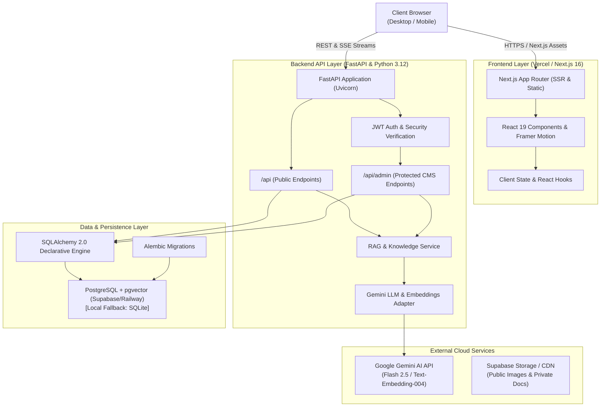
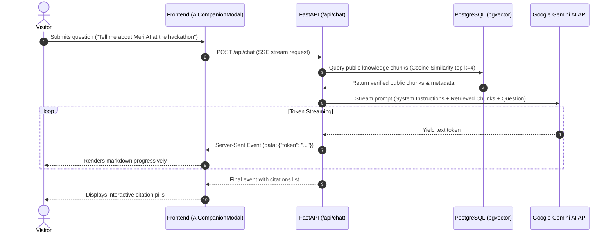

# SYSTEM ARCHITECTURE DOCUMENT
## Project: Temkin's World
**Author:** Temkin Abdulmelik & DeepMind Antigravity  
**Version:** 1.0.0  
**Status:** Approved Architecture Baseline  
**Date:** November 2026  

---

### 1. Architectural Overview & Style
Temkin's World is designed following a modern decoupled full-stack architecture with a Jamstack-compatible frontend, high-performance asynchronous REST & Streaming API backend, and a unified relational/vector data store.

---

### 2. Technology Stack & Component Rationale

| Tier | Technology | Version | Rationale & Architectural Purpose |
| :--- | :--- | :--- | :--- |
| **Frontend Framework** | Next.js (App Router) | 16.4.x | Server-Side Rendering (SSR) for lightning-fast SEO, static pre-rendering, optimized routing, and Turbopack build engine. |
| **Language (UI)** | TypeScript | 5.x | Strict type safety across API schemas, component props, and interactive states. |
| **Styling & Design** | Tailwind CSS & CSS Variables | 4.x | Tokenized design system with curated luxury palette, glassmorphism, responsive breakpoints, and custom typography classes. |
| **Motion & Animation**| Framer Motion | 14.x | Fluid, hardware-accelerated micro-interactions, layout transitions, modal reveals, and reduced-motion compliance. |
| **Backend Framework** | FastAPI (Python) | 0.115.x | Async ASGI framework with native OpenAPI/Swagger generation, Pydantic type validation, and high-throughput streaming capabilities. |
| **ORM & Database** | SQLAlchemy & Alembic | 2.0.x / 1.13.x | Decoupled database engine supporting both PostgreSQL with pgvector for production and SQLite for local development. |
| **AI & LLM Services** | Google Gemini API | gemini-2.5-flash | High-speed, high-context generative reasoning with minimal latency, token streaming, and low operational cost. |
| **Embeddings & Vector**| pgvector / text-embedding-004 | Native | Cosine similarity semantic search directly inside the relational database, eliminating the overhead of dedicated vector databases. |
| **Document Processing**| pypdf & python-docx | Latest | Server-side parsing of uploaded resumes, project briefs, and technical whitepapers into clean UTF-8 text for RAG chunking. |

---

### 3. Data Flow Architecture

#### 3.1 Public Content Flow
1. Visitor loads the application at root or specific routes (`/projects`, `/projects/[slug]`, `/about`, etc.).
2. The frontend fetches structured content from the FastAPI backend (`GET /api/profile`, `GET /api/projects`, `GET /api/technologies`, `GET /api/photos`).
3. Static assets (images, icons) are served via CDN/Next.js Image Optimization with responsive srcset generation.
4. User interactions (brewing coffee, giving cheers) send lightweight POST mutations (`/api/coffee/brew`, `/api/cheers`) that update database counters and return real-time feedback with quote selection.

#### 3.2 AI Assistant RAG Flow (Chat with Temkin's Universe)

#### 3.3 Admin Content Management & Ingestion Flow
1. Administrator authenticates via `POST /api/admin/login` receiving a signed JWT token.
2. In the Admin Studio, the admin uploads a new document (`POST /api/admin/knowledge/upload`).
3. The backend extracts text, segments it into semantic chunks (250–500 tokens), embeds chunks via Gemini embedding models, and writes records to `knowledge_docs` and `knowledge_chunks`.
4. Visibility can be set to `is_public=False` for private reference, guaranteeing it is excluded from public RAG retrieval.
5. Content edits to projects, profile, and gallery are immediately reflected in the public API.

---

### 4. Key Architectural Subsystems

#### 4.1 Modular Component Architecture (Frontend)
- `components/hero/HeroSection.tsx`: Editorial hero with live status pill, call-to-actions, and social links.
- `components/discovery/GetToKnowTemkin.tsx`: Personality exploration with interactive dimension cards and quiz.
- `components/projects/ProjectUniverse.tsx`: Multi-category filtered project grid with case-study links.
- `components/constellation/TechConstellation.tsx`: Categorized technology explorer connected to real projects.
- `components/timeline/EngineeringTimeline.tsx`: Vertical milestone journey from early ASTU days to recent hackathons.
- `components/gallery/PhotoGallery.tsx`: Masonry layout with category filtering and full-screen lightbox.
- `components/coffee/CoffeeCorner.tsx`: Animated brewing ritual modal with steam particles and inspirational quotes.
- `components/celebration/CheersButton.tsx`: Confetti celebration overlay.
- `components/ai-companion/AiCompanionModal.tsx`: Floating conversational AI drawer with SSE stream renderer.
- `components/terminal/EasterEggTerminal.tsx`: Keyboard-triggered simulated Unix CLI.

#### 4.2 Backend Service Decomposition
- `core/config.py`: Centralized environment configurations via Pydantic Settings.
- `core/security.py`: Password hashing (Bcrypt/Argon2id), JWT encode/decode, and auth dependencies.
- `models/entities.py`: SQLAlchemy declarative entities with relational foreign keys and JSON support.
- `services/rag_service.py`: Text extraction, recursive character chunking, embedding generation, and cosine similarity ranking.
- `services/gemini_service.py`: System prompt construction, streaming generator, and guardrail enforcement.
- `api/public.py`: Unauthenticated public content endpoints.
- `api/admin.py`: Authenticated CRUD and administration endpoints.

---

### 5. Architectural Quality Attributes & Decisions

- **ADR-01: Dual Database Support (PostgreSQL + pgvector in Production, SQLite in Development)**
  - *Context:* Developers may not have a running PostgreSQL daemon with pgvector installed locally.
  - *Decision:* Build the SQLAlchemy models to support SQLite with JSON-serialized vector arrays locally and native `pgvector` operators in production PostgreSQL.
- **ADR-02: Server-Sent Events (SSE) for AI Streaming**
  - *Context:* WebSockets introduce stateful connection management complexity on serverless and ephemeral containers.
  - *Decision:* Utilize HTTP-based SSE (`text/event-stream`), enabling seamless token streaming compatible with standard HTTP load balancers and reverse proxies.
- **ADR-03: Zero-Dependency Client Terminal Simulation**
  - *Context:* Interactive terminal easter egg should not create a remote code execution risk.
  - *Decision:* Implement the terminal exclusively in frontend TypeScript, mapping known command strings to safe simulated output strings.
